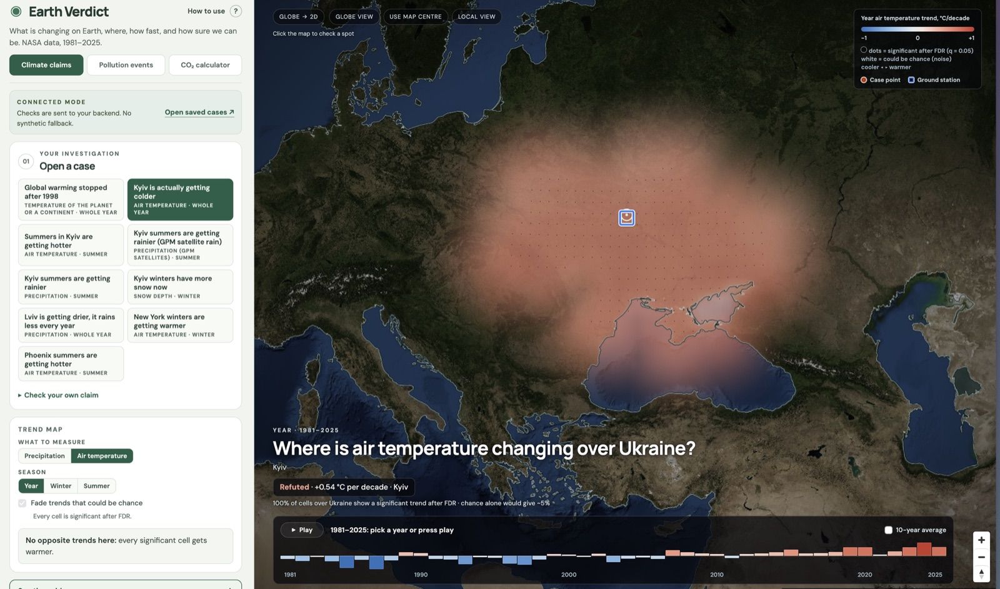
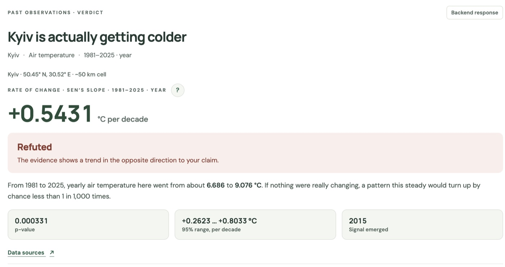
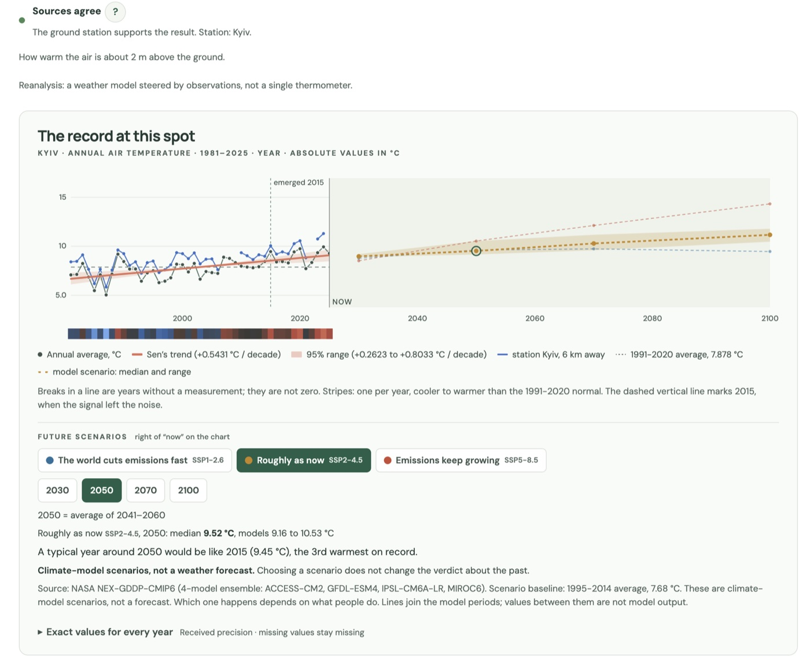

# Earth Verdict

**Fact-checking claims about our planet, backed by real NASA data.**

> NASA Space Apps Challenge 2026 · Challenge: *Be An Earth System Trend Detective!* · Team **Overflowers**

**Live:** [myhaven.fun](https://myhaven.fun)



---

## Why

NASA publishes thousands of Earth science variables, and tools like [Giovanni](https://giovanni.gsfc.nasa.gov/) can plot a time series with a trend line. Yet Giovanni's own manual warns that the line *"does not provide a scientific conclusion."*

For a student, a journalist or anyone curious about the planet, two things stay hard:

1. **Finding the right data** for a plain question like *"Are summers in Kyiv getting hotter?"*
2. **Knowing whether a line on a chart is real**, or just year-to-year weather that looks like a trend. Weather has memory, and moving the start year a little can make a "trend" appear or vanish.

Earth Verdict closes that gap: ask **what** is changing, **where**, **how fast**, and whether there is **enough evidence** to call it real.

## What it does

Three workspaces share one globe.

### Climate claims

Type a claim or open a saved case. The system checks it and returns one of three verdicts:

- **Confirmed**: a significant trend in the claimed direction that holds up under every check.
- **Not proven**: the record is too short or too noisy; the card estimates how many more years of data would settle it.
- **Refuted**: a significant trend in the opposite direction.



- **10 variables**: air temperature (mean, max, min), precipitation (NASA POWER and GPM satellites), snow depth, soil moisture, sunlight, evapotranspiration, global temperature.
- **Trend map over Ukraine**: 570 grid cells, colour by trend per decade, with cells that could be chance faded out after a false-discovery-rate correction (q = 0.05).
- **Timeline 1981–2025**: every year compared with the 1991–2020 normal; press play to watch it change.
- **Future scenarios**: NASA NEX-GDDP-CMIP6 ensembles for three emission pathways (SSP1-2.6, SSP2-4.5, SSP5-8.5), shown as illustration only. They never change the verdict about the past.



### Pollution events

Did the air change after a power plant opened or during a lockdown? For NO₂ and SO₂ (Aura OMI) and aerosols (MERRA-2), via NASA Giovanni:

- **Before vs after**, compared with a **control ring 120 km away** (BACI design), so a regional change is not credited to the site.
- **At least 3 placebo dates**: the same test on fake event dates must not show the same jump.
- Cases include Mundra (India), Sasan (India), Navajo (USA), Burshtyn (Ukraine) and the Los Angeles lockdown.

### CO₂ calculator

From tonnes of CO₂ to the atmosphere: emissions → ppm (44 % stays airborne) → radiative forcing (Myhre et al., 1998) → warming (IPCC AR6 transient response, 1.8 °C per doubling, likely range 1.4–2.2 °C). Current concentration from NOAA GML.

## How a claim is checked

1. **Plain language → fixed parameters.** Gemini maps the claim to a variable, place, season and period from a short curated list. Every field can also be set by hand.
2. **Statistics in code.** Mann–Kendall test with the Hamed–Rao autocorrelation correction, Sen's slope with a 95 % interval, and ordinary regression alongside for comparison. At least 15 years are required.
3. **Robustness.** The same test on 5 shifted periods; at least 4 must agree, so a trend that exists only for a hand-picked window is not called real.
4. **Second witness.** The nearest NOAA ground station within 50 km must not contradict the NASA series. If it does, the verdict says so.
5. **Plain-language answer.** The explanation is written by Gemini, but every number in it is checked against the computed result; if the AI writes a number the code did not produce, its answer is dropped and a text written by code is shown instead.

**The language model never computes or invents a number.** Every rate, p-value and year count comes from Python and links back to its dataset.

## Data

| Source | What | Used for |
|---|---|---|
| [NASA POWER](https://power.larc.nasa.gov/) (MERRA-2, CERES) | Temperature, precipitation, snow, soil moisture, sunlight; 1981–2025 | Main series, trend map, timeline |
| [NASA Giovanni](https://giovanni.gsfc.nasa.gov/) | GPM IMERG precipitation, GLDAS evapotranspiration, OMI NO₂ / SO₂, MERRA-2 aerosol optical depth | Extra variables, pollution events |
| [NASA NEX-GDDP-CMIP6](https://www.nccs.nasa.gov/services/data-collections/land-based-products/nex-gddp-cmip6) | Downscaled climate projections, 4–5 models per point | Future scenarios |
| [NASA GIBS](https://www.earthdata.nasa.gov/engage/open-data-services-software/earthdata-developer-portal/gibs-api) | Blue Marble and VIIRS Black Marble imagery | Globe background |
| [NOAA NCEI](https://www.ncei.noaa.gov/) (GHCN-Daily, GSOM) | Ground weather stations | Second witness |
| [NOAA Climate at a Glance](https://www.ncei.noaa.gov/access/monitoring/climate-at-a-glance/) | Global temperature since 1850 | Global claims |
| [NOAA GML](https://gml.noaa.gov/ccgg/trends/) | Global CO₂ concentration | CO₂ calculator |
| [Natural Earth](https://www.naturalearthdata.com/), [Open-Meteo](https://open-meteo.com/) | Country outlines, geocoding | Map shape, place search |

All datasets are open. Each result carries its sources, and saved cases in `data/cases/` are produced by the same code as live checks.

## Run it

### Docker (one command)

```bash
printf 'GEMINI_API_KEY=...\nEARTHDATA_TOKEN=...\n' > .env   # your keys
docker compose up -d --build                           # http://127.0.0.1:8790
docker compose --profile test run --rm backend-tests   # pytest
docker compose --profile test run --rm e2e             # Playwright
```

`GEMINI_API_KEY` is used to parse free-text claims and write explanations; saved cases work without it. `EARTHDATA_TOKEN` is needed only for Giovanni variables (GPM, GLDAS, OMI, MERRA-2 aerosols).

The public site runs with `compose.public.yaml` on top (nginx on port 80 behind a TLS proxy):

```bash
EV_PORT=8791 docker compose -f compose.yaml -f compose.public.yaml up -d --build
```

### Local development

```bash
python3 -m venv backend/.venv
backend/.venv/bin/pip install -r backend/requirements.txt
backend/.venv/bin/uvicorn app.main:app --app-dir backend --reload   # API on :8000

cd frontend && pnpm install --frozen-lockfile && pnpm dev           # UI on :5173
```

More detail: [backend/README.md](backend/README.md) (API, environment variables, deploy) and [frontend/README.md](frontend/README.md) (UI, demo mode, browser tests).

## Stack

Python · FastAPI · NumPy · SciPy · React 19 · TypeScript · MapLibre GL · Gemini API (Gemini 3.5 Flash-Lite) · Docker.

## Next

- Public fact-check API and embeddable widgets for newsrooms.
- New data: groundwater from GRACE.
- Trend maps beyond Ukraine; lessons for schools built around real cases.

---

*Built for the NASA Space Apps Challenge 2026. Not affiliated with or endorsed by NASA.*
